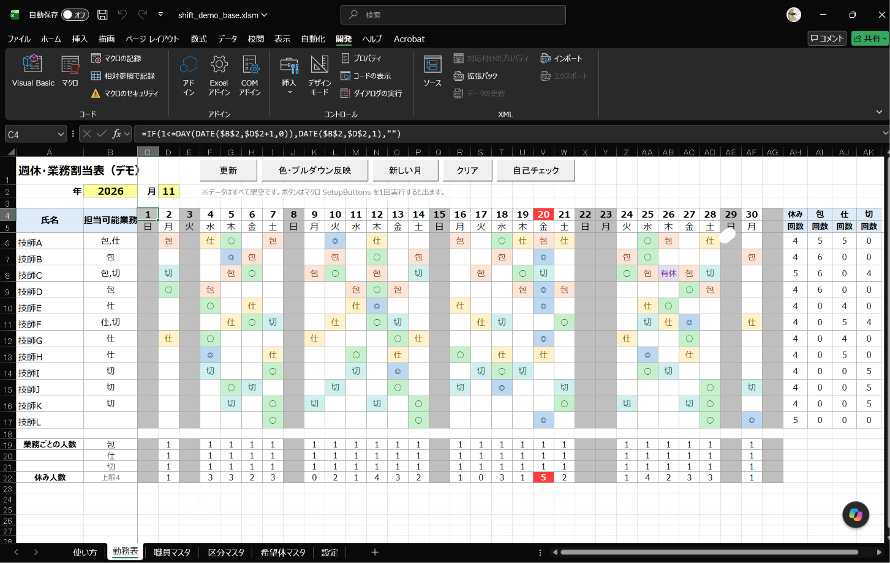
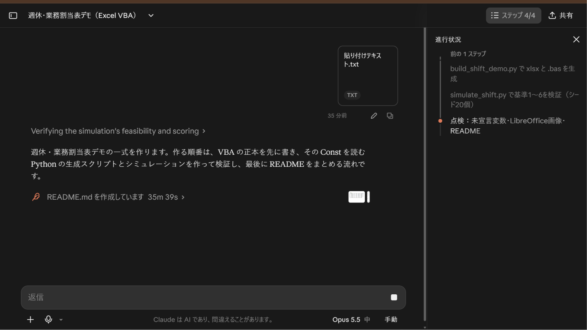
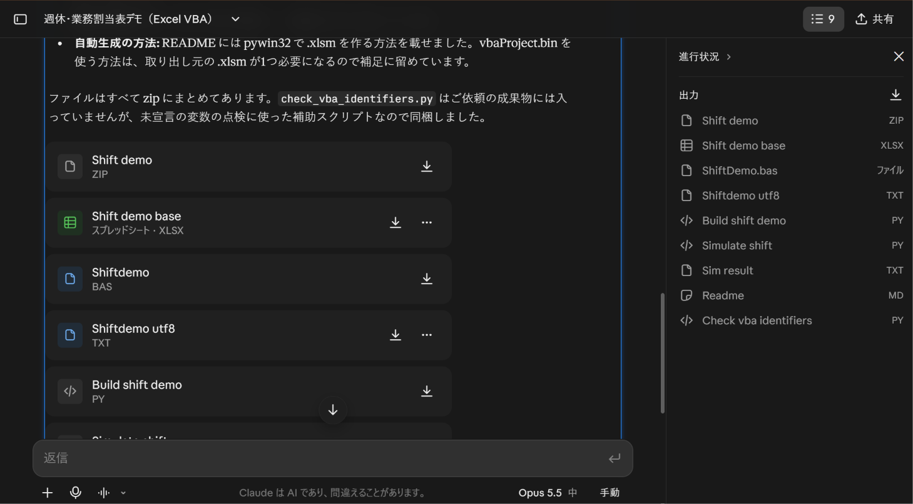
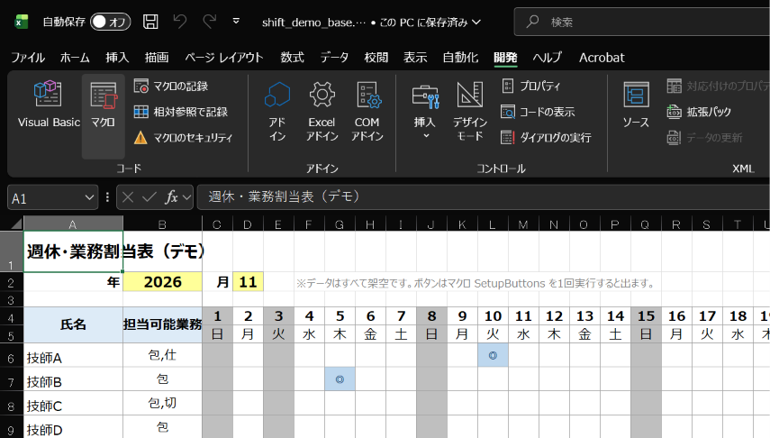

> ※ 本リポジトリは個人の活動として公開しています。特定の会社・組織を代表するものではなく、記載内容は所属先の公式見解ではありません。

# 週休・業務割当表デモ

AI にプロンプトを貼るだけで、Excel の勤務表がボタン1つで作れるデモです。

［更新］を実行した画面例です。11月20日の休み人数超過が赤で表示されています。

## このプロンプトで作るもの

[prompt.md](prompt.md) は、このデモを AI に作らせるための依頼プロンプトです。対象は架空の技師A〜L・12人の2026年11月の勤務表で、Excel VBA のボタンから週休と業務を割り当てます。

- 稼働日ごとに「包埋・仕分け・切り出し」を各1人に割り当てる。
- 週ごとに週休を割り当て、土曜固定の職員は原則土曜を休みにする。
- 希望休・有休を保ち、担当可能な業務の中で回数を均等にし、同じ業務の連続を避ける。
- 休み人数の上限は4人。動作例として、11月20日は休み希望が5人重なるため、そこだけ超過を赤く表示する。

受け入れ基準は、業務の不足がないこと、同じ人に同じ業務が連日入らないこと、業務回数の差が2以下であること、週休と土曜固定の条件を守ること、希望休を上書きしないこと、赤表示が11月20日の超過だけであることです。

## ここからプロンプトを調整

このリポジトリは、完成品をそのまま使うだけでなく、**`prompt.md` を調整して AI の出力を変えていくためのもの**です。人数、対象月、担当業務、休み方、表示や確認条件など、変えたい内容をプロンプトに追記・修正して、更新した全文を AI に渡してください。

AI の出力は毎回同じとは限りません。作例と表が一致するかではなく、勤務表の［自己チェック］やプロンプトの受け入れ基準を満たすかで確認します。条件に合わない場合は、結果を見てプロンプトをさらに調整し、もう一度作成を依頼します。

たとえば「対象月を変える」「人数を増やす」「業務の種類を変える」など、変更したいことを具体的に書き、関連する初期データや受け入れ基準も合わせて見直すと調整しやすくなります。

## 試し方

1. [prompt.md](prompt.md) を開き、右上の「Copy raw file」で全文をコピーします。
2. ファイル作成・コード実行ができる AI チャット（例：Claude）に貼り付けて送信します。
3. 返ってきた `shift_demo_base.xlsx` と `ShiftDemo.bas` をダウンロードします。
4. Excel で `.xlsx` を開き、`.xlsm` 形式で保存してから `ShiftDemo.bas` をインポートします。
5. マクロ `SetupButtons` を実行してボタンを作り、［更新］と［自己チェック］で確認します。

> 注意：プロンプトを送るだけでExcelですぐ使える状態になるわけではありません。AIが作成したファイルをダウンロードし、Excelへの取り込みや `SetupButtons` の実行などが必要です。

### AI に渡す画面例

プロンプトを送信し、AI が作業している画面の例です。

AI が作成したブックや VBA ファイルの一覧です。返るファイルは依頼内容によって異なります。

### Excel の「開発」タブがない場合

「ファイル」→「オプション」→「リボンのユーザー設定」を開き、右側の一覧で「開発」にチェックを入れて「OK」を押します。

表示後は、リボンに「Visual Basic」や「マクロ」が表示されます。

## AIを使わずに作例を試す

[example/shift_demo_base.xlsm](example/shift_demo_base.xlsm) をダウンロードして Excel で開きます。マクロの警告が表示されたら、内容を確認して「コンテンツの有効化」を選んでください。まず［自己チェック］で条件を確認し、［更新］を押して勤務表を作成できます。

作例の詳しい導入手順や操作方法は[作例の README](example/README.md)を参照してください。

## 検証結果

[Python シミュレーション結果](example/sim_result.txt)では、シード1〜20のすべてで基準1〜6に合格しています。Excel の VBA 実行確認は未確認です。作例の手順に従い、Excel 上で［自己チェック］を実行してください。詳しくは[作例の検証結果](example/README.md#検証結果)を参照してください。

作例は Claude にこのプロンプトを渡して作成したものです。データはすべて架空です。

ライセンス：MIT（[LICENSE](LICENSE)）
