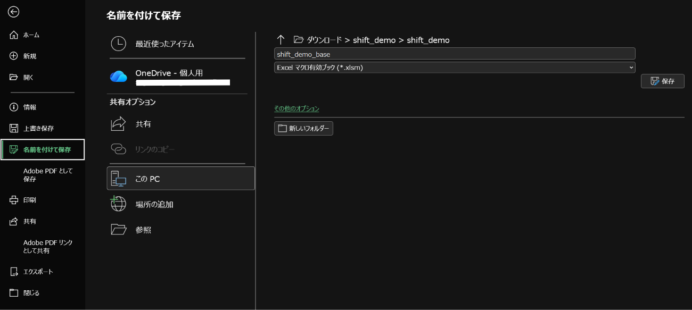
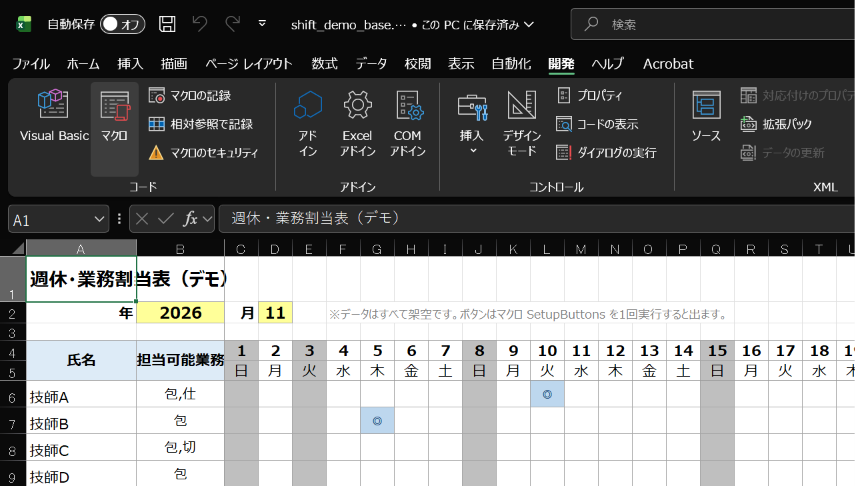
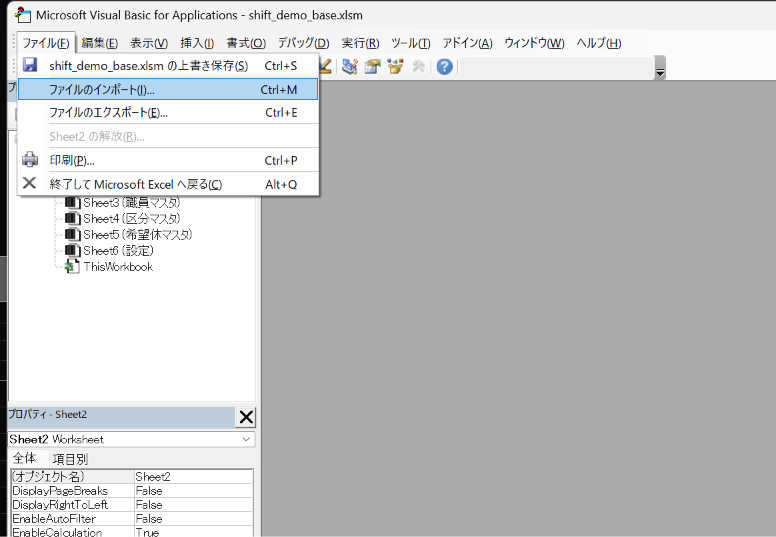
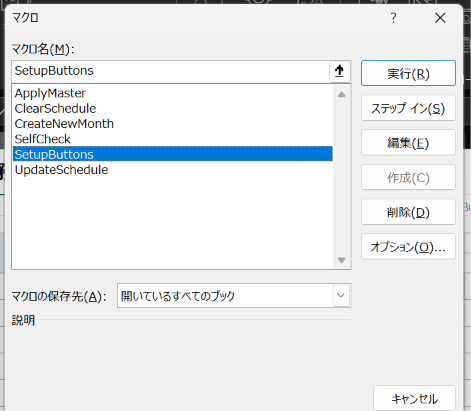
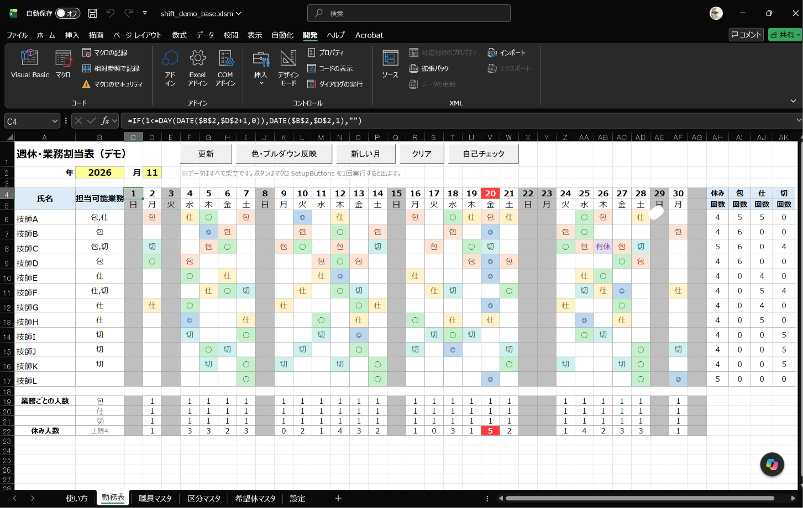

# 週休・業務割当表デモ（Excel VBA）

臨床検査室の「週休・業務割当表」を、Excel と VBA だけでボタン1つで作るデモです。
**データはすべて架空**です（職員は技師A～技師L。実在の氏名・施設名・患者や検体のデータは含みません）。

考え方は「ルールの順に当てはめる → ランダムに 400 回試す → 一番よい案（ペナルティ最小）を採る」という素朴な方法です。

## 同梱ファイル

| ファイル | 内容 |
|---|---|
| `shift_demo_base.xlsx` | シート・書式・初期データ入りのブック（**ボタンとマクロはまだ入っていない**） |
| `ShiftDemo.bas` | VBA 標準モジュール（Shift_JIS／CP932・改行 CRLF）。VBE でインポートする |
| `ShiftDemo_utf8.txt` | 同じコードの UTF-8 版（正本。閲覧・差分確認用） |
| `build_shift_demo.py` | `ShiftDemo_utf8.txt` から `ShiftDemo.bas` を作り、`shift_demo_base.xlsx` を作るスクリプト |
| `simulate_shift.py` | VBA と同じ手順を Python で再現して、受け入れ基準を検証するスクリプト |
| `sim_result.txt` | `simulate_shift.py` の実行結果 |
| `check_vba_identifiers.py` | （補助）VBA の未宣言の識別子と Public Sub の数を調べるスクリプト |

## 導入手順（Windows の Excel）

1. `shift_demo_base.xlsx` を開く。
2. 「ファイル」→「名前を付けて保存」で、種類を **Excel マクロ有効ブック（*.xlsm）** にして保存する。
3. 「開発」タブを表示する（「ファイル」→「オプション」→「リボンのユーザー設定」で「開発」にチェック）。
4. 「開発」→「Visual Basic」で VBE を開く。
5. VBE の「ファイル」→「ファイルのインポート」で `ShiftDemo.bas` を選ぶ（標準モジュール「ShiftDemo」ができる）。
6. VBE を閉じ、「開発」→「マクロ」で **`SetupButtons` を1回実行する。**
   → 勤務表シートの1行目に ［更新］［色・プルダウン反映］［新しい月］［クリア］［自己チェック］ の5つのボタンが出て、「ボタンを配置しました。」と表示されます。
7. 上書き保存する。以後はボタンで操作します。

> **ボタンは、`SetupButtons` を1回実行すると出ます。**
> `shift_demo_base.xlsx` を開いた時点ではボタンもマクロもありません（.xlsx はマクロを保存できないため）。
> 色分け・灰色・プルダウンは、ボタンを作る前から付いています。

`SetupButtons` は何度実行しても大丈夫です（`btn_マクロ名` という名前のボタンだけを消して作り直します）。

### 画面操作の Tips

- 「開発」タブが見当たらない場合は、「ファイル」→「オプション」→「リボンのユーザー設定」で「開発」にチェックを入れます。
- VBE では「ファイル」→「ファイルのインポート」から `ShiftDemo.bas` を選びます。文字化けを避けるため、ファイルをテキストエディタで開いて保存し直さず、そのままインポートしてください。
- `.xlsx` を開いた時点ではボタンはありません。`SetupButtons` を1回実行すると表示されます。

各項目を開くと画面例が表示されます。

<details>
<summary>保存・開発タブ・VBAのインポート・ボタン実行の画面を見る</summary>











</details>

### 補足：.xlsm を自動で作る（Windows＋Excel＋Python）

Excel の「ファイル」→「オプション」→「トラスト センター」→「トラスト センターの設定」→「マクロの設定」で
**「VBA プロジェクト オブジェクト モデルへのアクセスを信頼する」** にチェックを入れてから、pywin32（`pip install pywin32`）で次を実行します。

```python
import os
import win32com.client

here = os.path.abspath(".")
xl = win32com.client.Dispatch("Excel.Application")
xl.Visible = True                      # SetupButtons がシートを選択するので表示しておく
xl.DisplayAlerts = False
wb = xl.Workbooks.Open(os.path.join(here, "shift_demo_base.xlsx"))
wb.VBProject.VBComponents.Import(os.path.join(here, "ShiftDemo.bas"))
xl.Run("SetupButtons")                 # 完了メッセージが出るので OK を押す
wb.SaveAs(os.path.join(here, "shift_demo.xlsm"), FileFormat=52)   # 52 = .xlsm
wb.Close()
xl.Quit()
```

終わったら、セキュリティのため上のチェックは外しておくのがおすすめです。
（`vbaProject.bin` を XlsxWriter で埋め込む方法もありますが、vbaProject.bin を取り出すのに結局 .xlsm が1つ必要なので、ここでは上の方法を載せています。）

## 使い方

1. 「希望休マスタ」に、提出された希望休（氏名・日付・記号）を貼る。
2. 勤務表の［更新］を押す → 週休（○）と業務（包・仕・切）が入る。完了メッセージに「試行回数・ペナルティ・赤のセルの件数・所要秒数」が出る。
3. 赤いセルを確認する。初期データでは **11/20 の休み人数（5人＞上限4人）だけが赤** になります。

| ボタン | 動作 |
|---|---|
| ［更新］ | ○と業務記号を消して入れ直す（◎・有休は残す）。希望休を反映し、400 回試して最良案を書き出す。不足・超過を赤に |
| ［色・プルダウン反映］ | 区分マスタの記号・色を勤務表のプルダウンと条件付き書式に反映。灰色（日曜・祝日・月末超過）と名前の定義 `HolidayList` も作り直す |
| ［新しい月］ | 年・月（黄色）を変えたあとに押す。記号を全部消して新しい月の希望休を入れる（赤は付けない） |
| ［クリア］ | 自動で入れた ○ と業務記号だけ消す（録画の撮り直し用） |
| ［自己チェック］ | 受け入れ基準 1～5 を今の勤務表で判定し、合否と NG 箇所（各5件まで）を表示。末尾に（参考）休み上限の超過日 |

- 色を変えたいとき：区分マスタの L 列のセルの**文字の色**、M 列のセルの**塗りつぶしの色**を変えて［色・プルダウン反映］。
- 手入力した ○ や業務記号は、自動で入れたものと区別できないので［更新］で入れ直されます。
- 手でプルダウンを直すと色はすぐ変わりますが、集計の数字は次の［更新］で変わります。
- 設定シートの乱数シード（B4）に数字を入れると、何度押しても同じ結果になります（空欄なら毎回ランダム）。

## ルールのまとめ

- 稼働日＝日曜・祝日以外の月～土。対象週＝祝日でない土曜 d について「max(1, d−5)～d」。2026年11月は 11/2～7、11/9～14、11/16～21、11/23～28 の4週（11/30 だけの週は対象外）。
- 週休：対象週ごとに1人1回。土曜固定の人は土曜（ふさがっていれば他の稼働日）、通常の人は空いている稼働日からランダム。すでに ◎ がある週は追加しない。
- 業務：稼働日ごとに 包→仕→切 の順に1名ずつ。空欄の人で担当可能な人から、その業務の回数が少ない人を優先（同数は 1/k の確率で入れ替え）。同じ業務の2稼働日連続は、ほかに候補がいないときだけ許す。
- ペナルティ＝不足人数×100＋休み上限の超過人数×10＋同一業務の連続×5＋各業務の回数の（最大－最小）。

## レイアウトの一元管理

行・列の位置、シート名、決まった言葉（`○`・`週休`・`業務`・`土曜固定` など）は `ShiftDemo_utf8.txt` 先頭の `Public Const` にまとめてあります。
`build_shift_demo.py` と `simulate_shift.py` はこの `Public Const` を正規表現で読み取って使うので、Python 側に値の書き写しはありません。
コードを直すときは `ShiftDemo_utf8.txt` を編集し、`python build_shift_demo.py` で `ShiftDemo.bas` と `shift_demo_base.xlsx` を作り直してください（変換時に CP932 で読み戻して一致すること、改行がすべて CRLF であることを確かめます。CP932 で往復しない「〜」「−」などが入っていると止まります）。

## 検証結果

この作業環境（Linux）には Excel がないため、**VBA そのものは実行していません**。代わりに Python で同じ手順を再現して確かめました。

| 基準 | 内容 | 結果 |
|---|---|---|
| 1 | 全稼働日に 包・仕・切 が各1名 | **Python で確認済み**（シード1～20、追加で 1～200 も全合格）／Excel での実行は未確認 |
| 2 | 同じ業務の2稼働日連続なし | **Python で確認済み**／Excel での実行は未確認 |
| 3 | 業務回数の差（最大－最小）が2以下 | **Python で確認済み**（どのシードでも 包=1・仕=1・切=1）／Excel での実行は未確認 |
| 4 | 土曜固定の ○ は土曜、全員が対象週ごとに週休ちょうど1回 | **Python で確認済み**／Excel での実行は未確認 |
| 5 | 希望休（◎・有休）が上書きされていない | **Python で確認済み**／Excel での実行は未確認 |
| 6 | 赤は 11/20 の休み上限超過だけ | **Python で確認済み**（ペナルティは毎回 13＝超過1人×10＋差1×3）／Excel での実行は未確認 |
| 7 | 実行が数秒以内 | Python では 400 試行で約 0.1～0.2 秒。**Excel での実行時間は未確認** |
| 8 | 実在の個人名・施設名がない | 確認済み（職員は技師A～L、祝日名のみ） |

ほかに次を点検しました。

- `check_vba_identifiers.py`：全 51 プロシージャで未宣言の識別子なし、`Public Sub` は6つだけ（わざと誤字を入れると検出されることも確認）。
- 配列の添字：曜日別の必要人数（2=月～7=土）、対象週（最大5週に対し 1 To 6）、集計列（AH～AK＝1＋TASK_MAX 列）などを読み直して点検。
- `shift_demo_base.xlsx` を LibreOffice で画像化し、日曜・祝日（11/3・11/23）・31日の灰色、◎・有休の色分け、列幅を確認。

### Excel での確認手順（未確認の項目について）

1. 上の導入手順で .xlsm を作り、設定シートのシードが 1 であることを確かめる。
2. ［更新］を押し、完了メッセージで **赤のセル 1 件・所要秒数が数秒以内** であることを見る（試行回数は 400 回になります。11/20 の超過があるためペナルティが 0 にならず、途中で打ち切られないため）。
3. ［自己チェック］を押し、基準1～5 がすべて【OK】、（参考）の超過日が「11/20（5人）」だけであることを見る。
4. シードを変えたり空欄にしたりして、2～3 を何回か繰り返す。

### Python の結果と Excel の結果の違い

VBA の `Rnd` と Python の `random` は乱数列が違うので、**Excel での配置は `sim_result.txt` の表と同じにはなりません**。
同じなのは「基準を満たすこと」です。初期データは特定のシードでだけ通るものにならないよう、Python でシードを変えて確かめてあります。

```
python simulate_shift.py              # シード1の表＋シード1～20の検証（sim_result.txt を書き出す）
python simulate_shift.py --seeds 100  # シード1～100で検証
```

## 必要なもの

- Excel（Windows 版。Mac 版でもフォームボタンと VBA は動く見込みですが未確認）
- スクリプトを動かす場合：Python 3.9 以上、`openpyxl`
